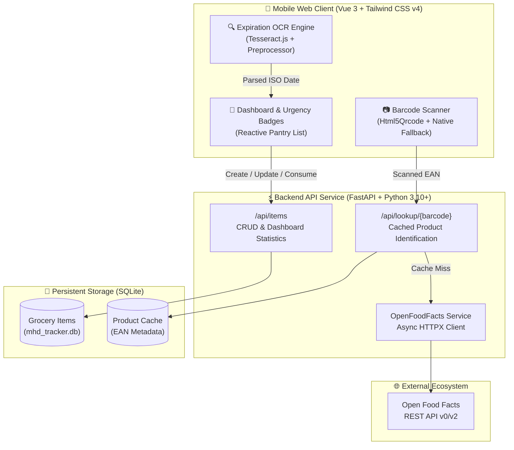

<div align="center">

# 🥫 MHD Tracker
### *Smart Expiration Date & Grocery Inventory Management*

[](https://github.com/CWACoderWithAttitude/mhd-tracker/actions/workflows/ci.yml)
[](https://www.python.org/)
[](https://astral.sh/uv)
[](https://fastapi.tiangolo.com)
[](https://vuejs.org/)
[](https://tailwindcss.com/)
[](https://opensource.org/licenses/MIT)

**A mobile-first, privacy-respecting Progressive Web App to defeat food waste.**<br>
Scan EAN barcodes, extract printed expiration dates (*Mindesthaltbarkeitsdatum*) using on-device optical character recognition (OCR), and enrich items automatically via the Open Food Facts catalog.

---

[🚀 Live Web App Preview](https://www.volker-benders.de/mhd-tracker/frontend/index.html) • [📊 Backend Coverage](https://www.volker-benders.de/mhd-tracker/coverage/backend/index.html) • [🧪 Frontend Coverage](https://www.volker-benders.de/mhd-tracker/coverage/frontend/index.html) • [🐙 GitHub Repository](https://github.com/CWACoderWithAttitude/mhd-tracker)

---

</div>

## 📚 Published Documentation & CI Artifacts

All documentation, test reports, and compiled single-page application (SPA) assets are automatically generated by the continuous integration pipeline and published to GitHub Pages:

| Artifact | Live GitHub Pages Link | In-Repository Path | Description |
|---|---|---|---|
| 🧪 **Backend Test Coverage** | [🔗 Open Pytest Coverage](https://www.volker-benders.de/mhd-tracker/coverage/backend/index.html) *(alt: [GitHub Pages](https://cwacoderwithattitude.github.io/mhd-tracker/coverage/backend/index.html))* | [`coverage/backend/index.html`](coverage/backend/index.html) | Complete line-by-line coverage analysis for FastAPI routers, SQLAlchemy models, Pydantic schemas, and external API services. |
| 🔬 **Frontend Test Coverage** | [🔗 Open Vitest Coverage](https://www.volker-benders.de/mhd-tracker/coverage/frontend/index.html) *(alt: [GitHub Pages](https://cwacoderwithattitude.github.io/mhd-tracker/coverage/frontend/index.html))* | [`coverage/frontend/index.html`](coverage/frontend/index.html) | Unit & heuristic test coverage for date parsing algorithms, OCR image binarization, and barcode camera helpers. |
| 📱 **Web Application (SPA)** | [🔗 Open Web App](https://www.volker-benders.de/mhd-tracker/frontend/index.html) *(alt: [GitHub Pages](https://cwacoderwithattitude.github.io/mhd-tracker/frontend/index.html))* | [`frontend/index.html`](frontend/index.html) | Production build of the Vue 3 + Tailwind CSS v4 single-page mobile client interface. |
| 🗂️ **Source Repository** | [🔗 GitHub Repository](https://github.com/CWACoderWithAttitude/mhd-tracker) | — | Main repository tracking development branches, issues, and pull requests. |

> [!TIP]
> **Custom Domain Notice:** The primary deployment is hosted at **`https://www.volker-benders.de/mhd-tracker/`**. If your environment routes through `github.io`, requests automatically resolve to the secure custom domain.

---

## 🌟 Key Capabilities

### 📷 1. Dual-Engine Barcode Recognition
- **Real-Time WebRTC Scanning:** High-framerate camera feed via `Html5Qrcode` scanning for EAN-13, EAN-8, UPC-A, UPC-E, and QR codes.
- **Fail-Safe Native Camera Fallback:** Integrated native camera input (`<input type="file" capture="environment">`) guarantees scanning capability even under plain HTTP or older mobile browsers where WebRTC permissions are restricted.
- **Instant Product Enrichment:** Queries the **Open Food Facts API** asynchronously and caches product titles, brands, packaging quantities, and imagery in SQLite `ProductCache`.

### 🔍 2. Client-Side Expiration Date OCR
- **Privacy & Speed:** Powered by on-device **Tesseract.js** — image frames never leave the smartphone.
- **Adaptive Contrast Enhancement:** Pre-processes camera crops with custom grayscale binarization, inverted luminescence, and threshold filtering to isolate stamped dot-matrix or ink-jet dates.
- **Smart European Heuristic Parser:** Accurately normalizes formats including:
  - `DD.MM.YYYY` / `DD.MM.YY` (e.g., `15.08.2026`)
  - Slash and dash variants: `DD/MM/YYYY`, `YYYY-MM-DD`
  - Textual month stamps: `24 APR 2026`, `01 OKT 25`
  - Month/Year representations: `05/2026` (auto-expanded to end-of-month)

### 📊 3. Reactive Inventory Dashboard
- **Visual Urgency Badges:**
  - 🔴 **Expired:** Overdue items highlighting days elapsed.
  - 🟠 **Expiring Soon:** High-priority items expiring within 3 days.
  - 🟢 **Fresh:** Safe items sorted by shelf life.
- **One-Tap Consumption:** Quick decrement or complete consumption of grocery items without cumbersome multi-step dialogues.
- **Location & Category Organization:** Filter by storage zones (Fridge, Pantry, Freezer, Spice Rack) and food categories.
- **Haptic & Audio Feedback:** Web Audio API generated confirmation chimes on successful scans.

---

## 🏗️ System Architecture



---

## 💻 Tech Stack & Tooling

| Domain | Technology | Key Highlights |
|---|---|---|
| **Backend Runtime** | **Python 3.10+** | Managed strictly with **`uv`** for lightning-fast dependency resolution |
| **API Framework** | **FastAPI** | Fully typed endpoints with asynchronous I/O and Pydantic v2 validation |
| **Database ORM** | **SQLAlchemy + SQLite** | Lightweight zero-config local persistence (`mhd_tracker.db`) |
| **Frontend Framework** | **Vue 3 (Composition API)** | Reactive Single File Components with `<script setup>` syntax |
| **Styling & Design** | **Tailwind CSS v4** | Dark-mode first, 44px+ mobile touch ergonomics, safe area insets |
| **Barcode Engine** | **Html5Qrcode** | Dual WebRTC stream + native `<input capture>` fallback |
| **Text Recognition** | **Tesseract.js** | Client-side neural OCR with custom canvas preprocessing |
| **Task Automation** | **GNU Make** | Canonical interface via [`Makefile`](file:///Users/volki/Dev/mhd-tracker/Makefile) |
| **Testing & QA** | **Pytest & Vitest** | Automated regression suites and branch coverage pipelines |

---

## 🛠️ Quickstart & Development

### 1. Requirements
- **Python**: `>= 3.10`
- **uv**: Modern Python package runner (`curl -LsSf https://astral.sh/uv/install.sh | sh`)
- **Node.js**: `>= 20.x` & `npm`

### 2. Common Make Commands

The project uses a unified [`Makefile`](file:///Users/volki/Dev/mhd-tracker/Makefile) for all tasks:

```bash
# Clone the repository
git clone https://github.com/CWACoderWithAttitude/mhd-tracker.git
cd mhd-tracker

# Install all dependencies (backend & frontend)
make install

# Run backend & frontend test suites with coverage
make test

# Build frontend and start the production server (HTTP)
make run

# Start secure HTTPS server (REQUIRED for mobile WebRTC live camera)
make run-ssl

# Run local CI pipeline mirroring GitHub Actions
make ci-local
```

### 3. Mobile Camera Setup
Mobile browsers (Safari on iOS, Chrome on Android) require a **Secure Context (HTTPS)** to access camera streams:
- Run `make run-ssl` to spin up the server with self-signed SSL certificates.
- Open `https://<YOUR-LOCAL-IP>:8000` on your mobile phone and accept the SSL prompt once.
- *Alternatively*: The native camera fallback button (**Take Photo**) operates over standard HTTP without SSL certificates!

---

## 🧪 Testing & Continuous Integration

Quality assurance is verified on every pull request and push to `main` through automated workflows:
- **Backend Linting:** Ruff and Black code format checking.
- **Backend Coverage:** Pytest with in-memory SQLite (`StaticPool`) verifying full CRUD and external catalog integration.
- **Frontend Quality:** ESLint, Prettier, and Vitest testing date parser heuristics and OCR preprocessing logic.
- **Automated Publishing:** Assembles and deploys live coverage reports and web assets directly to this `gh-pages` branch.

---

<div align="center">
<sub>Crafted with care to reduce household food waste. Licensed under <a href="https://opensource.org/licenses/MIT">MIT</a>.</sub>
</div>
